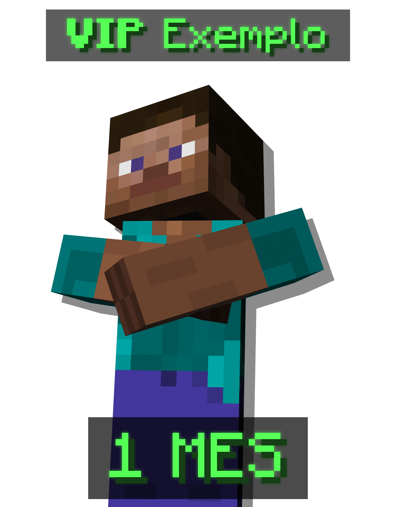

# skin-gen

Gerador de imagens de VIP para Minecraft. Ele pega a skin de um jogador, monta o personagem em 3D numa pose escolhida e salva uma arte em **PNG com fundo transparente**, com placa de nome em fonte do Minecraft e texto opcional embaixo.



## Funcionalidades

- **3 poses prontas**: braços cruzados, braços soltos e mãos na cintura, cada uma com câmera, enquadramento e sombra próprios.
- **Texto com códigos do Minecraft**: cores `&0` a `&f`, negrito `&l`, itálico `&o` e reset `&r`.
- **Placa automática**: o prefixo digitado vira `&a&lVIP &a<nick>` — o nick herda a cor do prefixo, mas sem negrito.
- **Busca de skin em 4 fontes**, em ordem de prioridade: arquivo local → vzge.me → Mojang → minotar (fallback).
- **Slim e classic**: o modelo é detectado pela textura e pelo metadado da Mojang, com opção de forçar por nome de arquivo.
- **Loop interativo**: depois de gerar, o programa já pede os dados da próxima imagem; `Enter` em branco repete o valor anterior.
- **Renderizador 3D próprio**, sem engine: cada texel da skin vira um polígono, com iluminação, sombra projetada e ordenação por profundidade.
- **Alta resolução**: de 1500×1920 a 1920×1920 px, fundo transparente.

## Requisitos

- [Node.js](https://nodejs.org) versão 18 ou superior (LTS recomendado).
- Conexão com a internet apenas para baixar skins e, na primeira execução, as dependências.

## Instalação

### Windows (forma mais simples)

1. Instale o Node.js LTS.
2. Baixe/extraia este repositório.
3. Dê **dois cliques em `INICIAR.bat`**.

O `.bat` verifica se as dependências estão instaladas, roda `npm install` na primeira vez e inicia o gerador.

### Qualquer sistema (macOS, Linux ou Windows terminal)

```bash
npm install
npm start
```

## Como usar

O programa faz quatro perguntas, nesta ordem:

| # | Pergunta | Exemplo | Observação |
|---|----------|---------|------------|
| 1 | Nome do VIP com cores | `&a&lVIP` | Aceita `&0`-`&f`, `&l`, `&o`, `&r` |
| 2 | Pose | `1` | `1` cruzados, `2` soltos, `3` cintura |
| 3 | Nickname | `Steve` | Letras, números e `_`, até 16 caracteres |
| 4 | Texto embaixo | `1 MES` | Opcional; `Enter` = nenhum |

Dica: deixar uma resposta em branco repete o valor usado na imagem anterior (exceto o nick).

### Cores do Minecraft

| Código | Cor | Código | Cor |
|--------|-----|--------|-----|
| `&0` | Preto | `&8` | Cinza escuro |
| `&1` | Azul escuro | `&9` | Azul |
| `&2` | Verde escuro | `&a` | Verde |
| `&3` | Ciano escuro | `&b` | Ciano |
| `&4` | Vermelho escuro | `&c` | Vermelho |
| `&5` | Roxo | `&d` | Rosa/magenta |
| `&6` | Dourado | `&e` | Amarelo |
| `&7` | Cinza | `&f` | Branco |

Formatação: `&l` negrito, `&o` itálico, `&r` volta ao padrão. Para um prefixo verde em negrito, use `&a&lVIP`; o nick sairá verde sem negrito.

## Skins: slim, classic e arquivos locais

A skin é obtida nesta ordem:

1. **`skins/<nick>.png`** — arquivo local, sempre tem prioridade (ideal para servidores pirata).
2. **`skins/<nick>.slim.png`** ou **`skins/<nick>.classic.png`** — mesma coisa, mas forçando o modelo.
3. **`https://vzge.me/skin/<nick>`** — primeiro serviço online tentado.
4. **Mojang** — perfil premium; o metadado `model: slim` é usado como fonte autoritativa.
5. **minotar** — fallback; se o nick não existir, ele devolve Steve/Alex.

O modelo é detectado automaticamente pela transparência das colunas usadas pelos braços finos (slim). Se uma skin customizada enganar a detecção, renomeie o arquivo para `NICK.slim.png` ou `NICK.classic.png` para forçar.

## Saída

Os PNGs são salvos na pasta `saida/`, com o nome `<POSE>_<nick>.png`, por exemplo:

```
saida/CRUZADOS_Steve.png
saida/SOLTOS_Alex.png
saida/CINTURA_Notch.png
```

A pasta é criada automaticamente e ignorada pelo Git.

## Como funciona

| Arquivo | Função |
|---------|--------|
| `INICIAR.bat` | Instala dependências na 1ª vez e inicia o programa no Windows |
| `src/gerar.ts` | Interface no terminal, composição da imagem e salvamento do PNG |
| `src/skin.ts` | Download/decodificação da skin, detecção do modelo e prioridade das fontes |
| `src/scene.ts` | Renderizador 3D: monta o corpo em caixas, aplica rotações, iluminação, sombras e gera os polígonos |
| `src/poses.ts` | Definições das 3 poses: rotações de membros, câmera, resolução e sombra |
| `lib/minecraft-font-renderer/` | Renderizador da fonte e das cores do Minecraft (licença ISC) |

O fluxo é: **skin 2D → modelo 3D poseado → lista de polígonos ordenados por profundidade → desenho com skia-canvas → placa e texto → PNG final**.

A espessura da segunda camada (overlay) da skin é controlada por `OV` e `OV_HEAD` em `src/scene.ts` — valores menores deixam o overlay mais colado ao corpo.

## Solução de problemas

- **`[ERRO] Node.js nao encontrado`** — instale o Node.js LTS e reabra o `.bat`.
- **`Nao foi possivel instalar skia-canvas/tsx`** — apague a pasta `node_modules` e rode `INICIAR.bat` de novo. O `package.json` já autoriza os scripts de instalação exigidos pelo npm 11.
- **`Nao consegui baixar a skin`** — verifique a internet ou coloque `skins/<nick>.png`.
- **Braços/corpo com espessura estranha** — confira se o modelo foi detectado certo; use o sufixo `.slim.png` ou `.classic.png` para forçar.
- **Texto com caracteres estranhos** — use apenas os códigos `&` documentados acima e caracteres ASCII.

## Estrutura do projeto

```
skin-gen/
├── INICIAR.bat
├── LEIA-ME.txt
├── README.md
├── LICENSE
├── package.json
├── docs/
│   └── exemplo.png
├── lib/
│   └── minecraft-font-renderer/   # fonte e cores do Minecraft (ISC)
├── skins/                         # coloque skins locais aqui
├── src/
│   ├── gerar.ts
│   ├── poses.ts
│   ├── scene.ts
│   └── skin.ts
└── saida/                         # PNGs gerados (criada automaticamente)
```

## Créditos e licença

- Fonte e sistema de cores: [`minecraft-font-renderer`](lib/minecraft-font-renderer) — licença ISC; bitmap da fonte pertence à Mojang.
- Renderização 2D: [skia-canvas](https://www.npmjs.com/package/skia-canvas); execução TypeScript: [tsx](https://www.npmjs.com/package/tsx).
- Skins obtidas de vzge.me, Mojang e minotar.
- Código deste projeto: licença [MIT](LICENSE).
